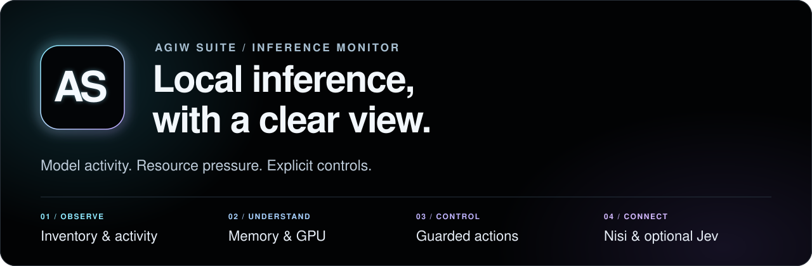
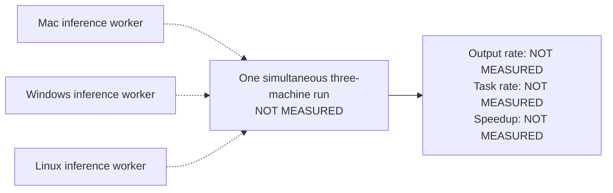
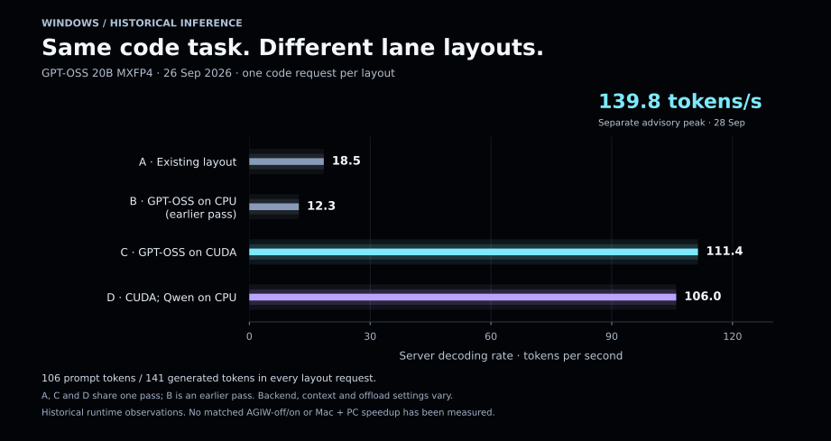

# AGIW Suite · Inference Monitor

A Mac menu-bar monitor for engineers running local models. See model activity, memory pressure and configured worker status, then use explicit controls when a model or service needs attention.

**[Download 1.0.0 for Apple silicon](https://github.com/louiscalata/agiw-suite/releases/download/v1.0.0/AGIW-Inference-Monitor-1.0.0-7-arm64.zip)** · [Release notes](https://github.com/louiscalata/agiw-suite/releases/tag/v1.0.0) · [SHA256SUMS.txt](https://github.com/louiscalata/agiw-suite/releases/download/v1.0.0/SHA256SUMS.txt)

[First run](#first-run) · [Activation guide](docs/activation.md) · [Features](#what-you-can-see-and-control) · [Performance & data](docs/performance.md) · [Local pipeline](#local-only-pipeline) · [Architecture & API](docs/architecture.md) · [Configuration](docs/advanced-configuration.md) · [Development](docs/development.md) · [Validation limits](#known-validation-limits)

**1.0.0 (7) · Apple silicon · macOS 13+ · Apache-2.0**

The download is Developer ID signed and Apple-notarized. [Known validation limits](#known-validation-limits) remain open; the Mac App Store edition follows a separate release process.

## Three machines, specialized roles

AGIW's development system is bringing **Mac, Windows and Linux** into one observable workflow. The intended workflow uses Nisi v0.2 and Jev task analysis, with optional NVIDIA PAIR transport between machine-local workers. The Windows PC has **two separate GPUs: an NVIDIA RTX 3080 Ti and an AMD RX 5700 XT**. Linux contributes GPU-assisted inference, NVMe workspace/cache and separate HDD backup storage.


**Historical, single-run samples (different tasks/configurations):** Linux **36.84 tokens/s**, Mac **16.39 tokens/s**, PC **2.06 tokens/s**, using each engine's reported generation rate. The Linux sample passed 16 semantic cases and the PC sample passed seven code cases; the Mac answer was **rejected by semantic review**, with its model unload confirmed.

These separate samples are not a hardware ranking or a cluster total. Mac, Windows and Linux may contribute separate inference workers, but genuine simultaneous three-machine output rate, task rate and speedup remain **NOT MEASURED**:



[See the current connection state, per-machine records and shared-run measurement plan](docs/three-machine-connection.md). This development checkpoint is separate from the downloadable macOS Monitor release.

## Development status (2026-10-23)

- **Before/after:** Before, the summary was dated 2026-10-18; after, it includes a high-level 2026-10-23 status. Measured values are unchanged, and this documentation refresh did not create a new benchmark.
- **Windows edition:** In development and not released.
- **Monitor hardening:** In development and not released; missing or unverified observations remain unknown rather than being presented as zero or idle.
- **Three-machine coordination:** Production integration remains in development. The worker diagram and **NOT MEASURED** results above describe measurement state, not machine readiness.

## Requirements

| Component | Requirement |
| --- | --- |
| Mac | Apple silicon (arm64), macOS 13 or later |
| Observer | Python 3.9+ at `/opt/homebrew/bin/python3`, `/usr/local/bin/python3` or `/usr/bin/python3` |
| Nisi self-check | External Apple-silicon Node.js 22+ at `/opt/homebrew/bin/node` or `/usr/local/bin/node` |
| Model activity | Separately installed model weights and configured local services such as LM Studio |
| Optional Jev | Your own TypeSafe API key and internet access; provider charges may apply |
| Optional routes/workers | Separately managed router and Windows components |

## First run

1. Download the ZIP and `SHA256SUMS.txt` into the same folder. In that folder, run `shasum -a 256 -c SHA256SUMS.txt`; expect `OK`.
2. Confirm Python is available at one of the paths above. Install the external Node runtime if you want the Nisi self-check.
3. Extract the ZIP, quit any running AGIW Monitor edition, and copy `Inference Monitor.app` into Applications.
4. Open the app. Click its menu bar chip icon for the compact monitor, or right-click and choose **Open Dashboard Window**.
5. Review local readings. Cards show unavailable or unknown when services or fresh evidence are absent. Open **Browse → Nisi & optional components** to inspect Nisi or run its fixed offline self-check.

**Next: [activate the suite](docs/activation.md).** The guide walks through connecting LM Studio, verifying Nisi, running the local-only model pipeline, optional Jev setup, existing router/PC connections and login startup—with expected results and troubleshooting.

## What you can see and control

| Capability | What you can do |
| --- | --- |
| **Observe models** | Inspect inventory, activity supported by fresh telemetry, and recorded client/route state. **Browse → Feeds & evidence** explains the observations. |
| **Understand resources** | See Mac memory pressure and best-effort GPU readings. Model-load admission estimates size and headroom before an explicit load. |
| **Choose an inventory view** | **Core 6** filters five pinned LLM IDs plus Nomic Embed Text v1.5. **All discovered** expands the Mac inventory; other reported in-use models stay visible. |
| **Control and recover** | Request guarded model load/unload and supported route/worker recovery. Optional automatic unloading uses fresh resident-pair and route checks; it is off by default. |
| **Inspect public Nisi** | Run the bundled 0.2.0 package’s fixed offline self-check, or explore its workflow engine, journal and CLI. External Node 22+ is required. |
| **Check optional Jev** | Set up your TypeSafe key securely and request a fixed hosted connectivity check. See the [execution and data details](#included-nisi-and-optional-jev-connection). |

Local services and weights are configured separately. Opening AGIW starts no coding task or model; changing a catalog view loads or unloads nothing. Missing or stale observations remain unknown. A loaded model or recorded worker state alone does not prove active generation or a successful route.

[Explore the component reference](docs/architecture.md) for runtime responsibilities, data flow, local HTTP routes and enforced guardrails.

See [advanced configuration](docs/advanced-configuration.md) for resident-model policy, share recovery and memory admission. For direct keyboard, video and mouse access to nearby headless workers, an optional [Mini-KVM](docs/advanced-configuration.md#optional-hardware-access-for-nearby-workers) can help with setup and recovery; native AGIW KVM integration remains unverified.

## Recorded inference performance

In the earlier performance study, one Windows fast-lane GPT-OSS 20B advisory on 28 September 2026 recorded **139.8 tokens/s** of server-reported decoding, with 201 prompt tokens and 265 completion tokens. Across its broader recorded 6.7-second job time, the approximate output rate was **39.6 tokens/s**; these are separate timing metrics. It is a historical observation of the separately configured inference worker. It does not measure AGIW's speedup or the downloadable application's performance.



The retained Apple-silicon Mac benchmark recorded **72.482 tokens/s median effective completion throughput across 21 requests**. That metric divides reported completion tokens by the **full request duration**; it is a different denominator from Windows server decoding speed. The two values cannot establish which machine is faster by a percentage.

| Requested before/after comparison | Matched measurement |
| --- | --- |
| No AGIW Suite | Not run |
| AGIW Suite on Mac | Not run |
| AGIW Suite on Mac + PC | Not run |

No controlled speedup percentage is available for these three conditions. The Mac benchmark's **21/21 non-empty responses measure availability, not graded accuracy**. [See the charts, generated-token counts, decode timings, methods and comparison protocol](docs/performance.md), [compare roles and instrumentation with Ollama and vLLM](docs/performance.md#agiw-ollama-and-vllm-roles-and-performance-instrumentation), or [download the sanitized aggregate data](docs/data/inference-performance.json). These records do not change the signed release or close native acceptance checks.

## Local-only pipeline

Use Nisi’s public CLI with a model server configured to run both models on this machine:

**Local author → JSON checks → four assertions → local reviewer → run report**

The fixed JSON-configuration example uses a loopback chat endpoint and different configured author/reviewer models. It allows one repair attempt and stops at its deadline. Generated JSON is checked as data; generated programs are never executed.

[Run the local-model example](docs/development.md#local-only-model-example). The GitHub app’s **Nisi self-check** is a separate, model-free example; the CLI does not run arbitrary repository tasks. Optional hosted Jev is separate from this local flow.

## Included Nisi and optional Jev connection

### Nisi · included

The public 0.2.0 workflow engine, journal, CLI, Apache-2.0 license and pinned manifest are bundled and verified offline. Its native fixed self-check uses the external Node runtime, loads no model and installs no weights. Expected report fields:

```json
{"outcome":"COMPLETED","reportStored":true,"modelCalls":0}
```

The public CLI provides fixed demonstrations; library APIs can define broader workflows. The private shared coding router is separately managed and is not bundled. [Public Nisi release](https://github.com/louiscalata/nisi/releases/tag/v0.2.0) · [CLI instructions](docs/development.md#public-nisi-cli)

### Jev · optional

On the Components page, **Set up Jev** opens a secure native dialog for your own TypeSafe API key. The signed helper stores it in the login Keychain. The key stays out of the browser and Python observer; saving it sends no network request.

**Check Jev connection** sends the key in an HTTPS authorization header and one fixed synthetic classification test to TypeSafe. The provider receives your IP address and standard request metadata; usage charges may apply. No files, task prompts or model inventory are sent.

This checks connectivity only. It does not enable coding-task routing or verify provider model identity. External Nisi/Jev router settings are separate. [TypeSafe API documentation](https://docs.typesafe.ai/api)

## Known validation limits

| Evidence | Build 7 status |
| --- | --- |
| **Distribution** | [Exact-source CI](https://github.com/louiscalata/agiw-suite/actions/runs/36758069996), notarization, signature/Gatekeeper checks, ZIP verification and installation parity passed on the maintainer’s Mac. |
| **Component checks** | Native Nisi offline self-check passed with zero model calls. One authorized fixed hosted Jev probe using an existing Keychain credential returned `connected`. |
| **Still open** | Complete native rendering/animation, a quarantined clean-Mac first install, and Jev Cancel/reopen and credential entry/save/remove remain unverified. |

The [roadmap](roadmap.md) records compiled source, package provenance and remaining acceptance work. The successful connection probe does not establish native setup acceptance, live task routing or provider model identity. [rc.2](https://github.com/louiscalata/agiw-suite/releases/tag/v1.0.0-macos-rc.2) and [rc.1](https://github.com/louiscalata/agiw-suite/releases/tag/v1.0.0-macos-rc.1) remain available for rollback.

## Development

Read the [architecture and capability reference](docs/architecture.md) for implementation boundaries. Use the [development guide](docs/development.md) for the local browser view, source checks, Nisi CLI and distribution packaging. The earlier [source-preview release](https://github.com/louiscalata/agiw-suite/releases/tag/v1.0.0-source-preview.1) remains available.

## Support and contributing

For bugs or documentation issues, [open an issue](https://github.com/louiscalata/agiw-suite/issues) with sanitized reproduction steps. For contributions, see [CONTRIBUTING.md](CONTRIBUTING.md).

## Security

Report vulnerabilities privately using [SECURITY.md](SECURITY.md). Keep credentials, private hostnames and sensitive machine state out of public issues.

## License

[Apache License, Version 2.0](LICENSE), matching public Nisi. Copyright 2026 Louis Calata. See [NOTICE](NOTICE). External model weights and separately managed services are not included.
