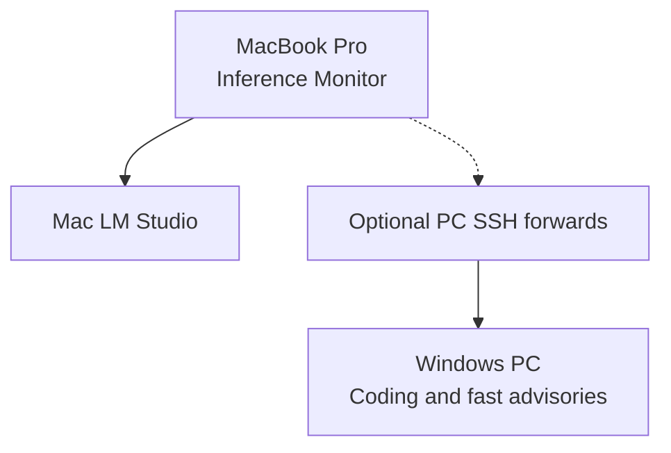

# AGIW Suite · Inference Monitor

A Mac menu-bar monitor for engineers running local models. See model activity, memory pressure and configured worker status, then use explicit controls when a model or service needs attention.

**[Download 1.0.0 for Apple silicon](https://github.com/louiscalata/agiw-suite/releases/download/v1.0.0/AGIW-Inference-Monitor-1.0.0-7-arm64.zip)** · [Release notes](https://github.com/louiscalata/agiw-suite/releases/tag/v1.0.0) · [SHA256SUMS.txt](https://github.com/louiscalata/agiw-suite/releases/download/v1.0.0/SHA256SUMS.txt)

[First run](#first-run) · [Activation guide](docs/activation.md) · [Features](#what-you-can-see-and-control) · [Performance & data](docs/performance.md) · [Local pipeline](#local-only-pipeline) · [Architecture & API](docs/architecture.md) · [Configuration](docs/advanced-configuration.md) · [Development](docs/development.md) · [Validation limits](#known-validation-limits)

**Download: 1.0.0 (7). Source: unreleased 1.2.0 (13).** Apple silicon · macOS 13+ · Apache-2.0. Building this checkout does not reproduce the released ZIP. See the [known local-control security issue](SECURITY.md#known-issue-in-v100-build-7-local-control-authentication), which still affects the download.

The download is Developer ID signed and Apple-notarized. [Known validation limits](#known-validation-limits) remain open. There is no Mac App Store release; an App Store edition would follow a separate release process.

## Source and release status

The instructions and feature table below describe the **1.0.0 (7) download**. The current source identifies itself as **1.2.0 (13), unreleased**. Its native window opens `/monitor`, polls `/api/inference` every two seconds without overlapping requests, expires old readings, and clears measurements when a refresh fails. **Full dashboard** links to `/` for the existing controls and Components view. The Mac map reuses telemetry's verified LM Studio inventory and configured endpoint. The source badge expects both Mac and Windows observations; an unconfigured PC keeps the combined count uncertain. Native control POSTs require the per-launch capability described in [SECURITY.md](SECURITY.md).

For a read-only source preview with Python 3.9+, run `python3 -B server.py --port 8765` and open `http://127.0.0.1:8765/monitor`. A standalone launch cannot dispatch control POSTs. See [development](docs/development.md) for tests and build boundaries.

Windows and two-machine coordination remain in development. The [dated connection record](docs/three-machine-connection.md) retains the maintainer's topology, retired Linux samples and measurement plan; simultaneous two-machine rate and speedup remain **NOT MEASURED**.

## Two machines, specialized roles

The Apple-silicon MacBook Pro handles interactive work, model review and the monitor interface. Its local model inventory comes from LM Studio. The optional, separately configured Windows PC worker provides specialized coding and fast advisory lanes; the Mac reads those lanes through SSH forwards. Windows and two-machine coordination remain in development.



Arrows mean "depends on"; dashed arrows mark optional dependencies.

The Linux Mac Pro and NVIDIA PAIR are retired from AGIW. They are excluded from this current dependency diagram. See the [connection record](docs/three-machine-connection.md) for configuration and dated acceptance limits.

## Requirements

| Component | Requirement |
| --- | --- |
| Mac | Apple silicon (arm64), macOS 13 or later |
| Observer | Python 3.9+ at `/opt/homebrew/bin/python3`, `/usr/local/bin/python3` or `/usr/bin/python3` |
| Nisi self-check | External Apple-silicon Node.js 22+ at `/opt/homebrew/bin/node` or `/usr/local/bin/node` |
| Model activity | Separately installed model weights and configured local services such as LM Studio |
| Optional Jev | Your own TypeSafe API key and internet access; provider charges may apply |
| Optional routes/workers | Separately managed router and Windows components |

## First run

1. Download the ZIP and `SHA256SUMS.txt` into the same folder. In that folder, run `shasum -a 256 -c SHA256SUMS.txt`; expect `OK`.
2. Confirm Python runs at one of the paths above. `/usr/bin/python3` requires the Xcode Command Line Tools; on a clean Mac, install those tools or a supported Python installation first. Install the external Node runtime if you want the Nisi self-check.
3. Extract the ZIP, quit any running AGIW Monitor edition, and copy `Inference Monitor.app` into Applications.
4. Open the app. Click its menu bar chip icon for the compact monitor, or right-click and choose **Open Dashboard Window**.
5. Review local readings. Cards show unavailable or unknown when services or fresh evidence are absent. Open **Browse → Nisi & optional components** to inspect Nisi or run its fixed offline self-check.

**Next: [activate the suite](docs/activation.md).** The guide walks through connecting LM Studio, verifying Nisi, running the local-only model pipeline, optional Jev setup, existing router/PC connections and login startup—with expected results and troubleshooting.

## What you can see and control

| Capability | What you can do |
| --- | --- |
| **Observe models** | Inspect inventory, activity supported by fresh telemetry, and recorded client/route state. **Browse → Feeds & evidence** explains the observations. |
| **Understand resources** | See Mac memory pressure and best-effort GPU readings. Model-load admission estimates size and headroom before an explicit load. |
| **Choose an inventory view** | **Core 6** filters five pinned LLM IDs plus Nomic Embed Text v1.5. **All discovered** expands the Mac inventory; other reported in-use models stay visible. |
| **Control and recover** | Request guarded local model load/unload. Route/worker recovery depends on separately installed maintainer integrations (`chami-dispatch`, `pc-llm`, the private router and configured share); these are not bundled or general-purpose setup tools. In the unreleased source, the native launcher leaves owner recovery closed. Optional automatic unloading is off by default. See the known local-control issue in SECURITY.md before using the released app. |
| **Inspect public Nisi** | Run the bundled 0.2.0 package’s fixed offline self-check, or explore its workflow engine, journal and CLI. External Node 22+ is required. |
| **Check optional Jev** | Set up your TypeSafe key securely and request a fixed hosted connectivity check. See the [execution and data details](#included-nisi-and-optional-jev-connection). |

Local services and weights are configured separately. Opening AGIW starts no coding task or model; changing a catalog view loads or unloads nothing. Missing or stale observations remain unknown. A loaded model or recorded worker state alone does not prove active generation or a successful route.

[Explore the component reference](docs/architecture.md) for runtime responsibilities, data flow, local HTTP routes and enforced guardrails.

See [advanced configuration](docs/advanced-configuration.md) for resident-model policy, share recovery and memory admission. For direct keyboard, video and mouse access to nearby headless workers, an optional [Mini-KVM](docs/advanced-configuration.md#optional-hardware-access-for-nearby-workers) can help with setup and recovery; native AGIW KVM integration remains unverified.

## Recorded inference performance

In the earlier performance study, one Windows fast-lane GPT-OSS 20B advisory on 28 September 2026 recorded **139.8 tokens/s** of server-reported decoding, with 201 prompt tokens and 265 completion tokens. Across its broader recorded 6.7-second job time, the approximate output rate was **39.6 tokens/s**; these are separate timing metrics. It is a historical observation of the separately configured inference worker. It does not measure AGIW's speedup or the downloadable application's performance.

| Windows layout | Fixed code-task decoding rate (tokens/s) |
| --- | ---: |
| A | 18.5 |
| B | 12.3 |
| C | 111.4 |
| D | 106.0 |

One observation per layout, each with 106 prompt tokens and 141 completion tokens; the separate advisory peak above used a different workload.

The retained Apple-silicon Mac benchmark recorded **72.482 tokens/s median effective completion throughput across 21 requests**. That metric divides reported completion tokens by the **full request duration**; it is a different denominator from Windows server decoding speed. The two values cannot establish which machine is faster by a percentage.

| Requested before/after comparison | Matched measurement |
| --- | --- |
| No AGIW Suite | Not run |
| AGIW Suite on Mac | Not run |
| AGIW Suite on Mac + PC | Not run |

No controlled speedup percentage is available for these three conditions. The Mac benchmark's **21/21 non-empty responses measure availability, not graded accuracy**. [See the tables, generated-token counts, decode timings, methods and comparison protocol](docs/performance.md), [compare roles and instrumentation with Ollama and vLLM](docs/performance.md#agiw-ollama-and-vllm-roles-and-performance-instrumentation), or [download the sanitized aggregate data](docs/data/inference-performance.json). These records do not change the signed release or close native acceptance checks.

## Local-only pipeline

Use Nisi’s public CLI with a model server configured to run both models on this machine:

**Local author → JSON checks → four assertions → local reviewer → run report**

The fixed JSON-configuration example uses a loopback chat endpoint and different configured author/reviewer models. It allows one repair attempt and stops at its deadline. Generated JSON is checked as data; generated programs are never executed.

[Run the local-model example](docs/development.md#local-only-model-example). The GitHub app’s **Nisi self-check** is a separate, model-free example; the CLI does not run arbitrary repository tasks. Optional hosted Jev is separate from this local flow.

## Included Nisi and optional Jev connection

### Nisi · included

The public 0.2.0 workflow engine, journal, CLI, Apache-2.0 license and pinned manifest are bundled and verified offline. Its native fixed self-check uses the external Node runtime, loads no model and installs no weights. Expected report fields:

```json
{"outcome":"COMPLETED","reportStored":true,"modelCalls":0}
```

The public CLI provides fixed demonstrations; library APIs can define broader workflows. The private shared coding router is separately managed and is not bundled. [Public Nisi release](https://github.com/louiscalata/nisi/releases/tag/v0.2.0) · [CLI instructions](docs/development.md#public-nisi-cli)

### Jev · optional

On the Components page, **Set up Jev** opens a secure native dialog for your own TypeSafe API key. The signed helper stores it in the login Keychain. The key stays out of the browser and Python observer; saving it sends no network request.

**Check Jev connection** sends the key in an HTTPS authorization header and one fixed synthetic classification test to TypeSafe. The provider receives your IP address and standard request metadata; usage charges may apply. No files, task prompts or model inventory are sent.

This checks connectivity only. It does not enable coding-task routing or verify provider model identity. External Nisi/Jev router settings are separate. [TypeSafe API documentation](https://docs.typesafe.ai/api)

## Known validation limits

| Evidence | Build 7 status |
| --- | --- |
| **Distribution** | [Exact-source CI](https://github.com/louiscalata/agiw-suite/actions/runs/36758069996), notarization, signature/Gatekeeper checks, ZIP verification and installation parity passed on the maintainer’s Mac. |
| **Component checks** | Native Nisi offline self-check passed with zero model calls. One authorized fixed hosted Jev probe using an existing Keychain credential returned `connected`. |
| **Still open** | Complete native rendering/animation, a quarantined clean-Mac first install, and Jev Cancel/reopen and credential entry/save/remove remain unverified. |

The [roadmap](roadmap.md) records compiled source, package provenance and remaining acceptance work. The successful connection probe does not establish native setup acceptance, live task routing or provider model identity. The rc.2 and rc.1 candidates remain as the tags `v1.0.0-macos-rc.2` and `v1.0.0-macos-rc.1`; their release pages are no longer published, so v1.0.0 is the only download. The CI run and the roadmap name commits by their ids before a later history rewrite that changed commit metadata only; the roadmap [maps each to its current commit](roadmap.md#commit-ids-before-the-history-rewrite) with the same source tree.

## Development

Read the [architecture and capability reference](docs/architecture.md) for implementation boundaries. Use the [development guide](docs/development.md) for the local browser view, source checks, Nisi CLI and distribution packaging. The earlier source preview remains as the tag `v1.0.0-source-preview.1`.

## Support and contributing

For bugs or documentation issues, [open an issue](https://github.com/louiscalata/agiw-suite/issues) with sanitized reproduction steps. For contributions, see [CONTRIBUTING.md](CONTRIBUTING.md).

## Security

Report vulnerabilities privately using [SECURITY.md](SECURITY.md). Keep credentials, private hostnames and sensitive machine state out of public issues.

## License

[Apache License, Version 2.0](LICENSE), matching public Nisi. Copyright 2026 Louis Calata. See [NOTICE](NOTICE). External model weights and separately managed services are not included.
