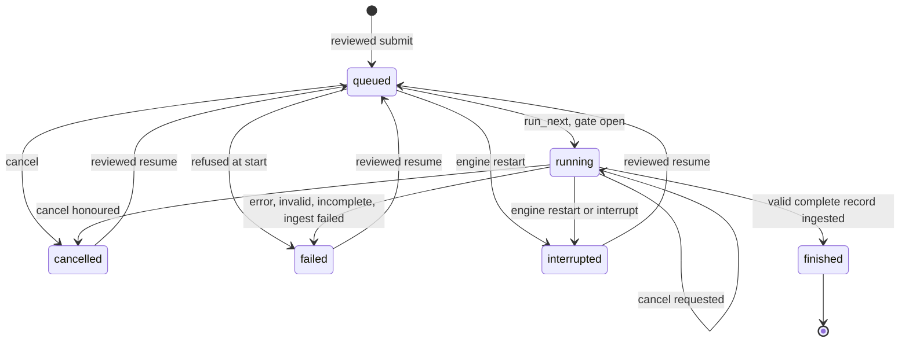

# Check jobs

`eci_jobs.py` queues, tracks, cancels and ingests screening checks, one at a
time. It is an engine only. It has no page and no thread. `eci_job_routes.py`
adds three [read-only routes](#read-only-routes) that the observer serves only
when it is handed an engine. `eci_job_host.py` builds one from an explicit
config when the observer is started with `--check-jobs-config PATH`
([Host](#host)). Its gate is closed, so no check can be submitted or started.
All real checks are **NOT_RUN**.

A screening check is a [model fast check](eci-fast-check.md) run by the
[loopback adapter](eci-model-tuning.md#run-a-fast-check-against-an-existing-server)
against a lane that is already serving. Its result is a fast-check record. It
is not an ECI score and it selects no model for routing.

## Rules

- **Fail closed.** Every unreviewed, unknown or undecided state refuses. A
  refusal has a stable code and fixed text.
- **The gate ships closed.** `Engine(state_dir)` with no other argument refuses
  every submission, resume and start. There is no environment variable and no
  file that opens it.
- **Reviewed submission.** A job is queued only with a review that names the
  SHA-256 of the exact normalized request and attempt.
- **One job at a time.** One engine owns a state directory. One job runs.
- **It starts nothing.** The engine never starts a model, a server or a lane.
  It passes a base address to a runner. If the lane is not serving the model,
  the job fails.
- **Reading starts nothing.** Status, job detail and preview never write to the
  journal and never call the runner.
- **Nothing resumes by itself.** After a restart, a job that was running or
  queued becomes `interrupted`. Only a new reviewed resume queues it again.
- **Ingest only valid, complete records for the reviewed request.** A record
  is validated and compared with the reviewed request before it reaches the
  dataset. An invalid, incomplete, cancelled or mismatched result leaves the
  dataset untouched.
- **Append-only state.** Each change is a new journal entry that supersedes the
  previous one for that job. No entry is rewritten or removed.

## Decisions the engine does not make

Three owner decisions are open. `Policy` holds them, and its default refuses.

| Decision | `Policy` field | Default | Effect of the default |
| --- | --- | --- | --- |
| Is a check owner-gated, and what opens it? | `gate` | a function that returns `False` | `gate_closed` on submit, resume and start |
| Which lanes may be targets? | `allowed_targets` | empty | `target_not_allowed` for every lane |
| Wall budget cap and default | `max_wall_budget_s`, `default_wall_budget_s` | none | `budget_refused`, or `budget_required` when the request names no budget |

The gate opens only when `gate()` returns exactly `True`. Any other value, or
an exception, is closed. The dataset folder is also undecided: `DatasetSink`
takes a folder and has no default.

The policy is read again on every check. A budget cap that is no longer a
valid budget string counts as undecided and refuses with `budget_refused`.

## States



Each arrow depends on the state at its tail. `finished` is final. A job has at
most 16 attempts.

## Interface

```python
import eci_jobs

engine = eci_jobs.Engine(
    state_dir,                      # absolute; holds jobs.jsonl, engine.lock and runs/
    policy=eci_jobs.Policy(...),    # default: eci_jobs.CLOSED
    targets=lambda: [...],          # remote_machines.lane_targets(config)
    sample_sets={"screening": ["/absolute/path/samples.json"]},
    runner=eci_jobs.adapter_runner, # default: None, which refuses
    sink=eci_jobs.DatasetSink(dataset_dir),  # default: None, which refuses
    now=..., clock=...,             # injected in tests
)
```

| Call | Writes | Result |
| --- | --- | --- |
| `status()` | nothing | `status` (`ok` or `unknown`), `reason`, `owner`, `gate`, `jobs`, `active` |
| `job(job_id)` | nothing | one job view |
| `preview(request)` | nothing | normalized request, `job_id`, `review_sha256`, `effects`, `refusals` |
| `preview_resume(job_id)` | nothing | the same, for the next attempt |
| `submit(request, review)` | one `queued` entry | job view; the same submission again returns the same job and writes nothing |
| `resume(job_id, review)` | one `queued` entry with the next attempt | job view; the same resume again writes nothing |
| `cancel(job_id)` | `cancelled`, or a `running` entry with `cancel_requested` | job view; repeating writes nothing |
| `run_next()` | `running`, then one final entry | the job view, or `None` when nothing is queued |
| `eci_jobs.read_status(state_dir)` | nothing, takes no lock | job list as the journal records it, for a read-only mirror |

`read_status()` reports what the journal says, not what is happening. It takes
no lock and cannot tell whether an engine is alive. If the owning engine died
during a run, the journal still ends with a `running` entry, so `read_status()`
shows that job as `running` and names it in `active` until an engine opens the
directory and marks it `interrupted`. A `running` state from `read_status()` is
not evidence that anything is running. `Engine.status()` does not have this
limit: it holds the lock, and it reports `owner`.

A request has `submission_id`, `target`, `model_id` and `sample_set`, and may
have `count`, `max_tokens`, `wall_budget_s`, `request_timeout_s`,
`disable_thinking` and `facts`. Any other field refuses. Normalizing makes every
default explicit, so the review covers the values that will run.

- `target` is a registry lane id such as `registry:machine:lane`. The lane must
  be in the registry when the job is submitted and again when it starts. Its
  address must be a loopback lane address. The eight protected ports refuse.
- `max_tokens` must be at most the context the registry advertises for the
  lane. See [Lane context](#lane-context).
- `model_id` is a public model identifier, never a path or an address.
- `sample_set` names a configured set. A request cannot name a file path.
- `wall_budget_s` is an exact positive decimal string of at most 32
  characters, at most the policy cap. A longer string refuses with
  `invalid_request` before it is converted, on every supported Python version.
  The same length limit applies to the two `Policy` budget fields.
- `facts` are the adapter's optional model and hardware facts: a lowercase
  SHA-256, sizes and short public descriptors. `model_label` must be a public
  model identifier like `model_id`, because the adapter writes it as the
  record's model name. `already_loaded` is not a fact and not a request
  field: a job cannot state that a lane is already loaded, so a job against a
  lane whose available memory is unknown still fails at the adapter's fit gate.

`job_id` is derived from the normalized request, which includes
`submission_id`. `review` is exactly
`{"reviewed": true, "review_sha256": "<from preview>"}`. The digest covers the
job id, the attempt and the request, so a review cannot be reused for another
request or for a later attempt.

`preview` lists every reason a submission would be refused now, and the
effects a reviewer must see: the target lane, the sample set, the planned
number of requests, the upper bound with one retry per item, the wall budget,
`starts_model: false`, `lane_context_tokens` and what is written.
`lane_context_tokens` is the lane's `contextTokens` from the registry, or
`null` when the lane advertises none or the value is not a nonnegative
integer. It is what the registry says, not a measurement.

Refusal codes: `invalid_request`, `budget_required`, `budget_refused`,
`not_reviewed`, `review_mismatch`, `gate_closed`, `unknown_target`,
`protected_port`, `invalid_target`, `target_not_allowed`, `context_exceeded`,
`unknown_sample_set`,
`not_configured`, `samples_unreadable`, `queue_full`, `journal_full`,
`journal_unavailable`, `not_owner`, `unknown_job`, `not_resumable`,
`not_cancellable`, `busy`.

`samples_unreadable` appears only in the `refusals` list of a preview, when the
configured sample files cannot be read or planned. Submit does not read the
sample files; a job whose files cannot be read fails when the runner loads
them.

### Lane context

A registry lane may carry `contextTokens`
([lane registry](three-machine-pipeline.md)). The engine compares the reviewed
`max_tokens` with it on preview, submit, resume and again at start, and
refuses with `context_exceeded` when `max_tokens` is larger. It reads the
registry entry only. It contacts no lane and no model.

| Registry entry | Result |
| --- | --- |
| No `contextTokens` | Unknown. Not refused here; `lane_context_tokens` is `null`. |
| A nonnegative integer, `max_tokens` at most that value | Passes. |
| A nonnegative integer, `max_tokens` above it | `context_exceeded`. |
| `0` | `context_exceeded` for every request, because the smallest `max_tokens` is 8192. |
| Any other value | `context_exceeded`. |

A job whose lane advertises too little at start fails with
"Refused at start: context_exceeded" and the runner is not called.

This check saves a whole run that could not be ingested. It does not replace
the exact comparison in [Record binding](#record-binding). `contextTokens` is
written by the operator and is not verified against the server. If the server's
real context is smaller than the registry says, the adapter still lowers
`max_tokens` and the record is still refused after the run.

## Read-only routes

`eci_job_routes.ReadOnlyRoutes(engine)` maps three GET paths to the three
engine reads. It calls `status()`, `job()` and `preview()` and nothing else.

| GET path | Engine call | Answer |
| --- | --- | --- |
| `/api/eci-jobs` | `status()` | 200 with the status object, also when `status` is `unknown` |
| `/api/eci-jobs/jobs/<job_id>` | `job(job_id)` | 200 with one job view; 404 `unknown_job` |
| `/api/eci-jobs/preview?<request>` | `preview(request)` | 200 with the preview, including its `refusals` |

The preview query names each request field at most once: `submission_id`,
`target`, `model_id`, `sample_set`, `wall_budget_s`, `count`, `max_tokens`,
`request_timeout_s`, `disable_thinking` and `facts.<name>` for a fact. Integers
are plain decimal digits. `disable_thinking` is `true` or `false`. A query that
is empty, longer than 4096 characters, repeats a field or names an unknown
field answers 400 `invalid_request` with fixed text. The query on the other
two paths is ignored.

A refusal answers `{"status": "refused", "code": ..., "message": ...}` with the
engine's code and text. `invalid_request` is 400. `unknown_job` and an unknown
path are 404. `not_owner` and `journal_unavailable` are 503. Every other
refusal is 409.

The observer (`server.py`) serves these paths under the same Host and Origin
rule as its other reads. A request from another host or origin gets 403 before
the engine is read. Answers are JSON and are not cached.

- `MonitorServer(..., check_jobs=None)` is the default. There is no engine, no
  state directory and no file opened at startup. `/api/eci-jobs` then answers
  200 with `status: unknown`, `gate: closed`, no jobs and the reason "Check
  jobs are not configured." The other two paths answer 503 with the same
  reason.
- `server.py` imports no part of the engine at startup. Only
  `open_check_jobs()` imports `eci_job_host`, and `main()` calls it only when
  `--check-jobs-config` is given. `build.sh` and `package-release.sh` bundle
  `eci_jobs.py`, `eci_job_routes.py`, `eci_job_host.py` and
  `eci_fast_check_adapter.py`.
- There is no POST route. A POST, PUT, PATCH or DELETE to these paths reaches
  no engine. Submit, resume, cancel and start stay Python calls.
- An engine opened with no policy shows `gate: closed`, and every preview
  refuses with `budget_required` or `budget_refused`.
- A preview reads the configured sample files to plan the request count. The
  observer closes a connection after two seconds, so a very large sample set
  can time out a preview. Nothing is written when that happens.
- If the route object raises or returns something that is not a status and a
  JSON object, the answer is 503 `{"status": "unknown"}`.

## Host

`server.py --check-jobs-config PATH` builds one engine at startup and serves
its read-only routes. Without the flag nothing changes: no engine, no state
directory, and the status path answers "Check jobs are not configured."

`PATH` is an absolute JSON file. It must be a regular file owned by the user,
not a link, not writable by group or others, and at most 64 KiB. Keys are
unique and every field below is required. Any other field refuses, including
any field that names a gate.

| Field | Value |
| --- | --- |
| `state_dir` | Absolute folder for `jobs.jsonl`, `engine.lock` and `runs/`. Use a local folder, not a network share: it is opened before the observer listens. |
| `dataset_dir` | Absolute folder for `DatasetSink`. Not the state folder. |
| `sample_sets` | Up to 8 set ids, each with 1 to 16 distinct absolute sample file paths. |
| `allowed_targets` | Registry lane ids such as `registry:pc:fast`. Up to 64, no repeats. |
| `max_wall_budget_s` | Exact positive decimal string, the cap. |
| `default_wall_budget_s` | Exact positive decimal string, at most the cap. |

The host builds `Engine(state_dir, policy=Policy(gate=lambda: False, ...),
targets=..., sample_sets=..., runner=eci_jobs.adapter_runner,
sink=DatasetSink(dataset_dir))`. The targets are
`remote_machines.lane_targets(remote_machines.load_config())`, read again on
every check, so a preview follows the registry as it is now. The host opens no
socket, starts no thread and contacts no lane.

The gate is not configurable. Submit, resume and start refuse with
`gate_closed`, and every preview lists `gate_closed` first. It stays closed
until owner decision D1 says what opens it.

If the file cannot be read safely, or is not valid, no engine is built and no
folder is created. The status path answers 200 with `status: unknown`, a
closed gate and one fixed reason: "The check-job configuration cannot be read
safely." or "The check-job configuration is not valid." The other two paths
answer 503 with the same reason. An engine that cannot be built answers
"The check-job engine cannot be opened." The observer still starts, and prints
`{"checkJobs": "ok"}` or `{"checkJobs": "error"}` on standard error. The
engine releases its lock when the observer stops.

### Lanes and budget chosen for this host

Decided under delegation on 15 Nov 2026, from the lane registry on this Mac:

| Lane | Port | `contextTokens` | Allowed | Why |
| --- | --- | --- | --- | --- |
| `registry:pc:fast` | 11247 | 32768 | yes | |
| `registry:pc:review` | 11237 | 16384 | yes | |
| `registry:pc:glimmer` | 11236 | none | no | Labelled retiring; advertises no context. |
| `registry:macpro:glimmer` | 11280 | 4096 | no | Below the 8192 minimum `max_tokens`, so no record could be ingested. |

Wall budget cap and default: `"1500"` seconds. The gate stays closed.

```json
{
  "state_dir": "/Users/<you>/Library/Application Support/AGIW/check-jobs/state",
  "dataset_dir": "/Users/<you>/Library/Application Support/AGIW/check-jobs/dataset",
  "sample_sets": {"screening": ["/absolute/path/to/samples.json"]},
  "allowed_targets": ["registry:pc:fast", "registry:pc:review"],
  "max_wall_budget_s": "1500",
  "default_wall_budget_s": "1500"
}
```

With this config a preview for `pc:fast` or `pc:review` refuses only with
`gate_closed`. `pc:glimmer` adds `target_not_allowed`. `macpro:glimmer` adds
`target_not_allowed` and `context_exceeded`. `pc:review` with `max_tokens`
32768 adds `context_exceeded`. A budget above 1500 refuses with
`budget_refused`. The sample sets are not chosen yet; the path above is a
placeholder.

## Running a job

`run_next()` runs the oldest queued job to its end in the calling thread. The
caller decides when to call it. A second call while a job runs refuses with
`busy`. The gate, the policy, the registry and the sample set are checked again
at start. A closed gate leaves the job queued. A lane that left the registry or
the policy fails the job without calling the runner. So does a lane whose
advertised context is now below the reviewed `max_tokens`.

The gate is checked on submit, on resume and at start only. Closing it while a
job runs does not stop the runner and does not block ingestion of that job's
record. Cancel stops a running job.

The runner contract is `runner(spec, should_stop, progress)`:

- `spec` is the normalized request plus `base_url`, `sample_files`,
  `output_dir`, `job_id` and `attempt`. Every attempt of a job uses the same
  output directory, `runs/<job_id>`, so the adapter continues from its durable
  checkpoint.
- `should_stop()` returns `None`, `"cancel"` or `"budget"`. A runner asks
  between items and raises `eci_jobs.Stopped` when told to stop.
- `progress(completed, planned)` is kept in memory for the running job only.
- The return value is a fast-check record.

| Runner outcome | Final state | Dataset |
| --- | --- | --- |
| Valid, complete record that is bound to the request, and the sink accepts it | `finished` | record added |
| Cancel was requested, whatever the runner returned | `cancelled` | untouched |
| Record fails `validate_record` | `failed` | untouched |
| Record has another model name, `max_tokens`, count, wall budget or declared model hash | `failed` | untouched |
| A benchmark attempted fewer items than planned | `failed`, checkpoint kept | untouched |
| The sink raises | `failed` | untouched |
| The runner raises | `failed`; only the exception type, or a validator's fixed text, is kept | untouched |
| `Stopped` at the wall budget | `failed` | untouched |
| `KeyboardInterrupt` or another interrupt | `interrupted`, then the interrupt propagates | untouched |

An incomplete record is not ingested because a resumed attempt would produce a
second record for the same model with a different id.

### Record binding

A record is ingested only when all of these equal the reviewed request. Each
is compared whether or not a model hash was declared.

| Record field | Must equal |
| --- | --- |
| `model.name` | `facts.model_label` when the request has one, otherwise `model_id` |
| `runtime_settings.max_tokens` | `max_tokens`, as an integer |
| `plan.items_per_benchmark` | `count` |
| `plan.wall_budget_s` | `wall_budget_s` |
| `model.file_sha256` | `facts.model_sha256`, only when the request declares one |

Any difference fails the job with "The record does not match the reviewed
request." and the dataset is untouched. The rule is exact on purpose:

- The adapter lowers `max_tokens` to the lane's context size when the context
  is smaller. That record ran with a setting the reviewer did not approve, so
  it is refused. Submit a new request whose `max_tokens` is at most the lane's
  context. The smallest allowed value is 8192, so a lane with a smaller
  context cannot produce an ingestible record through this engine. When the
  registry advertises the lane's context, [Lane context](#lane-context)
  refuses such a request before the run.
- A record with no runtime settings or no `max_tokens` is refused.
- Without a declared hash the model file is identified only by the name the
  lane advertises. Declare `facts.model_sha256` to bind the file itself.

`adapter_runner` binds a job to the adapter's public `run()`. The adapter has
no stop or progress hook. With this runner a cancel takes effect before the
first request and when `run()` returns, and the adapter's own wall budget
bounds the time in between. Progress stays unknown. A per-item hook in the
adapter is a follow-up.

## Journal

`jobs.jsonl` holds one JSON entry per line. Each entry has a sequence number,
the SHA-256 of the previous entry and its own SHA-256. The hashes detect
accidental edits. They do not authenticate deliberate rewriting.

- Each entry is written and synced before memory changes. An entry that replay
  would reject is never written.
- Replay checks every hash, the sequence and every state change. An unknown
  state, an illegal move, a missing entry or an entry out of sequence makes the
  journal damaged. Then status is `unknown`, the job list is empty, and submit,
  resume, cancel and start refuse. The file is left as it is.
- A tail is every byte after the last valid entry: an unterminated line, or
  any number of complete lines that do not validate, including a last entry
  whose own SHA-256 no longer matches. A crash that cuts the last line is one
  cause, not the only one. A tail is never applied. On the next open the owner
  terminates an unterminated line and appends a `repair` entry that names the
  SHA-256 of exactly the skipped bytes. The bytes stay in the file. A complete
  entry that lost only its newline is kept.
- Two consequences of that rule, both on the safe side. A journal that holds
  only invalid lines opens as `ok` with no jobs, after a repair entry. A
  damaged last entry of a `finished` job is skipped, so the job reverts to
  `running` in the journal and becomes `interrupted` at open; the dataset
  keeps the record, and nothing runs again without a new reviewed resume.
- An invalid line before a valid entry is accepted only when that entry is a
  `repair` entry naming the SHA-256 of exactly those bytes. Anything else is
  damage. An edit to a middle entry is damage even when the edited values
  would be a legal state change, because the entry's own SHA-256 no longer
  matches.
- `engine.lock` is held for the life of the engine. A second engine on the same
  directory owns nothing: its status is `unknown` and its actions refuse with
  `not_owner`. Holding the lock at open proves that no engine is running the
  jobs, which is why running and queued jobs can be marked `interrupted`.
- The journal is a regular file of at most 8 MiB with at most 256 jobs. A link
  refuses. New work refuses 1 MiB before the limit, which leaves room for
  running jobs to record their end. Every request field is bounded in length,
  so a `queued` entry is a few kilobytes at most.

The journal holds the normalized request, states, fixed reasons, record ids,
the post decision and per-benchmark counts. It holds no prompt, no answer and
no server text.

## Dataset sink

`DatasetSink(folder)` adds one record to `fast_checks` in `folder/dataset.json`,
the normalized dataset the Model evaluation page reads.

- The record is validated first. The whole candidate dataset is then validated
  by `eci_tuning.ingest` from a temporary file in the same folder.
- The run, comparison-pair and size limits of the dataset reader are checked,
  so the sink cannot write a dataset the reader would refuse.
- The file is replaced atomically, and only if it did not change during
  validation. Any failure leaves the existing file untouched and removes the
  temporary file.
- A record that is already present is not written again.

## Boundaries

- Pre and post decisions stay deterministic local functions in the fast-check
  core. The engine sends nothing to Jev or to another model.
- The record's `journal` field is a Nisi journal reference or null. The engine
  does not create a Nisi journal and does not read one.
- The engine imports no model control, no process launcher and no socket code.

## Not in this module

- Server routes for reviewed submit, resume and cancel, with the native
  capability header. Only the three reads above exist.
- A route for `preview_resume`.
- A read-only or 501 Windows mirror. The Windows observer answers 404 on the
  check-job paths.
- Opening the gate (owner decision D1).
- Passing `--check-jobs-config` from `login-agent.sh` and the app. Today the
  flag is used only when the observer is started by hand.
- Bundling `eci_jobs.py` and the adapter in the Windows installer.
- The check queue, check detail and reviewed submission on the Model
  evaluation page.
- A stop and progress hook in the adapter, so that a cancel is honoured between
  items with the real adapter. A cancel route is not useful before this hook
  exists: with `adapter_runner` a running check stops only at its wall budget.
- A context reading from the lane itself. The pre-check trusts the registry
  entry.
- A worker thread that calls `run_next()` after a reviewed submit.
- The gate decision, the dataset folder and the sample files. The lanes and
  the budget are chosen for the host ([Host](#host)); the engine defaults
  still refuse.
- Journal rotation.
- A way for `read_status()` to report whether an engine holds the lock.
- A link from `docs/README.md` and a roadmap entry.

## Tests

`test_eci_jobs.py` and `test_eci_jobs_context.py` use a fake runner, fake
clocks and temporary folders. They open no socket and call no model.
`test_eci_job_routes.py` uses the same fakes. It also starts the observer in
the test process on a loopback port chosen by the system and requests the
routes from it. `test_eci_job_host.py` builds the real engine from a temporary
config and a temporary copy of the lane registry, and requests its routes the
same way. They contact no lane and no model.

```sh
PYTHONDONTWRITEBYTECODE=1 python3 -B -m unittest test_eci_jobs test_eci_jobs_context test_eci_job_routes test_eci_job_host -q
```
