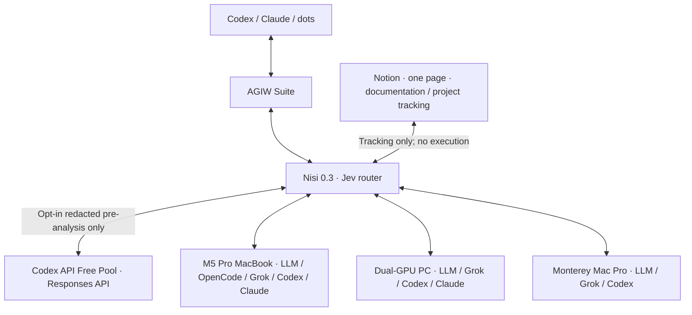

# AGIW private fleet routing draft

This is an isolated prototype based on the November 17 sketch. It is not a claim
that the public release, installed Mac app, or individual workers support it yet.



## First slice

`agiw.fleet_routing_plan` is a pure decision function. It does not send prompts,
read credential files, acquire leases, launch agents, probe peers, apply
edits, or write configuration. A plan is not a dispatch receipt.

- Prefer the M5 for routine local work and the dual-GPU PC for heavier work.
  The Monterey Mac Pro is a candidate only with fresh authenticated readiness,
  a ready local model, an available lease, and a known non-busy state. The
  same eligibility checks apply to every worker, including the MacBook.
- Local mode cannot select a hosted route. Online mode requires separate opt-in
  and a redacted summary before proposing Jev. Only an explicit Jev-unavailable
  result makes the dedicated Responses API key and approved budget relevant.
  Missing evidence does not activate the free pool. Billing attribution is
  verified in the API dashboard, not inferred from the model name.
- Grok is a human-authorized fallback for checking an otherwise unreachable
  machine, not a substitute for authenticated readiness and never a reason to
  include credentials, code or Notion data. No automated Grok dispatch is included.
- Notion has a separate documentation and project-tracking lane. The planner
  refuses to use a Notion-sourced request to start a worker or model, even if
  hosted mode is enabled. No Notion content goes to the pool, and no pool
  credentials, configuration or usage go to Notion. A future tracking adapter
  must be restricted to one approved page and use only ordinary progress data.
  No Notion connector or page permission is changed by this patch.

## Before live use

1. Pin and verify a compatible Nisi 0.3 release. The shipped Monitor bundle is
   still 0.2.0; this patch does not change it.
2. Issue fresh, authenticated readiness for each worker. Wire atomic lease
   acquisition before dispatch; evidence that a lease is available is not a
   lease or proof that a worker will remain idle.
3. Run a single local job with bounded draft, checks and separate review.
   Capture the actual receipt before enabling another machine.
4. Separately validate the dedicated Responses project with one approved
   nonsensitive call; confirm the dashboard attribution. Do not wire automatic
   fallback until there is an enforced request cap, timeout and retry policy.
5. Integrate the verified worker and router adapters on a private candidate.
   Do not publish a release or change the installed Mac bundle based on this test.

Run the isolated checks:

```sh
PYTHONDONTWRITEBYTECODE=1 python3 -B -m unittest discover -s tests_cli -p test_fleet_routing_plan.py -v
```

## Private executable follow-up (not deployed)

`agiw.fleet_local_pilot` now connects this routing decision to an isolated pinned
Nisi 0.3.1 engine and bounded loopback author adapter. See
`preview-pilot/README.md` for exact limits, source pin, run commands and evidence.
The fixture is tested end-to-end without inference. Live execution remains
blocked by unavailable verified loaded/idle model metadata. Its deterministic
checker is not independent LLM review. The preview-only lock is not a backend
lease or authenticated peer link, and the installed bundle remains unchanged.
