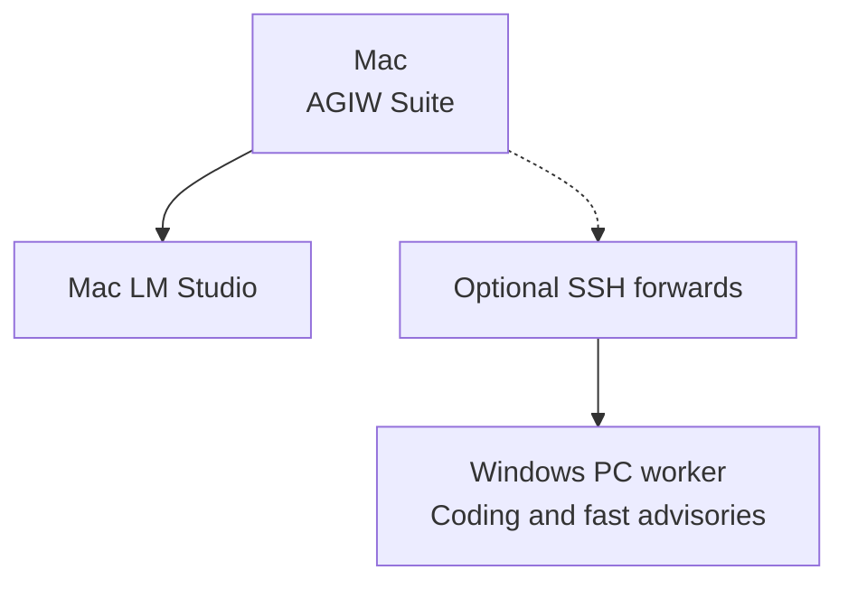

# Status

What the AGIW Suite download and the source each cover, how the two machines connect, and which checks are still open. For the evidence trail, see the [roadmap](../roadmap.md).

## Release status

- **Download:** 1.0.0 (build 7). It is Developer ID signed and Apple-notarized, and is published on GitHub only. There is no Mac App Store release; an App Store edition would follow a separate release process.
- **Known issue:** the 1.0.0 (7) download's local control routes do not authenticate callers ([details](../SECURITY.md#known-issue-in-v100-build-7-local-control-authentication)). The published v1.1.0 source adds a per-launch capability. That check is not in the download.
- **Tags:** v1.0.0 is the only release with an app to install. v1.1.0 is a source release with no files to download. The tags `v1.0.0-macos-rc.2` and `v1.0.0-macos-rc.1` remain, but their release pages are no longer published. The tag `v1.0.0-source-preview.1` marks the earlier source preview.
- **Commit ids:** the CI run and the roadmap name commits by their ids before a later history rewrite that changed commit metadata only. The roadmap [maps each to its current commit](../roadmap.md#commit-ids-before-the-history-rewrite), with the same source tree.

## Source status

The source in this checkout is **1.1.0 (build 14)**, published as the source tag [v1.1.0](https://github.com/louiscalata/agiw-suite/releases/tag/v1.1.0). That tag has no Mac app attached. The earlier label 1.2.0 (13) was not shipped. Building this source does not reproduce the 1.0.0 (7) ZIP. It differs from the download as follows.

- The native window opens `/monitor` and polls `/api/inference` every two seconds without overlapping requests.
- Old readings expire, and measurements clear when a refresh fails.
- **Full dashboard** links to `/` for the existing controls and Components view.
- The Mac map reuses telemetry's verified LM Studio inventory and configured endpoint.
- The source badge expects both Mac and Windows observations. An unconfigured PC keeps the combined count uncertain.
- Native control POSTs (requests that change state, such as loading a model) require the per-launch capability described in [SECURITY.md](../SECURITY.md).

To preview the source read-only with Python 3.9+, run `python3 -B server.py --port 8765` and open `http://127.0.0.1:8765/monitor`. A standalone launch cannot dispatch control POSTs. Tests and build boundaries: [development](development.md).

## Two-machine status

The Apple-silicon Mac runs interactive work, model review and the monitor. Its model inventory comes from LM Studio. An optional, separately configured Windows PC worker provides coding and fast advisory lanes, which the Mac reads through SSH forwards.

Arrows mean "depends on"; dashed arrows mark optional dependencies.

Windows and two-machine coordination are in development. Simultaneous two-machine rate and speedup are **NOT MEASURED**. The Linux Mac Pro and NVIDIA PAIR were earlier machines. They are retired and not part of this layout. Configuration, dated acceptance limits, the retired Linux samples and the measurement plan are in the [connection record](three-machine-connection.md).

## Open checks

| Evidence | Build 7 status |
| --- | --- |
| **Distribution** | [Exact-source CI](https://github.com/louiscalata/agiw-suite/actions/runs/36758069996), notarization, signature and Gatekeeper checks, ZIP verification and installation parity passed on the maintainer’s Mac. |
| **Component checks** | The native Nisi offline self-check passed with zero model calls. One authorized fixed hosted Jev probe, using an existing Keychain credential, returned `connected`. |
| **Still open** | Complete native rendering and animation, a quarantined clean-Mac first install, and Jev Cancel/reopen and credential entry, save and remove remain unverified. |
| **Clean-Mac install** | **NOT_RUN.** Steps and the receipt template are in [release-checklist.md](release-checklist.md). No receipt is stored. |
| **Forced colors** | Ubuntu CI emulates `forced-colors: active` in Chromium on `/` and `/monitor`, in light and dark. Windows High Contrast on hardware: NOT_RUN. |

The Jev probe tests connectivity only. It does not establish native setup acceptance, live task routing or provider model identity. The [roadmap](../roadmap.md) records compiled source, package provenance and remaining acceptance work.
