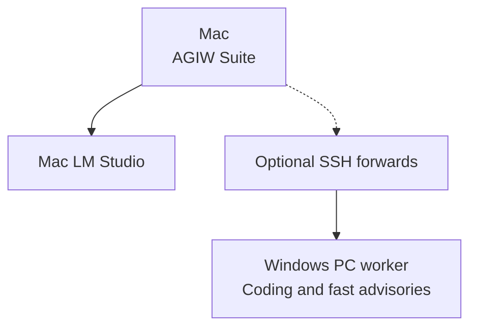

# Status

What the AGIW Suite download and the source each cover, how the two machines connect, and which checks are still open. For the evidence trail, see the [roadmap](../roadmap.md).

## Release status

- **Latest download:** [1.1.1 (build 15)](https://github.com/louiscalata/agiw-suite/releases/tag/v1.1.1), an Apple-silicon DMG built from `54479a1`. It is Developer ID signed, has no Apple notarization ticket, and is published on GitHub only. There is no Mac App Store release.
- **Older download:** 1.0.0 (build 7) was Developer ID signed and notarized. Its local control routes have a [known authentication issue](../SECURITY.md#known-issue-in-v100-build-7-local-control-authentication). The 1.1.1 download includes the per-launch capability fix.
- **Other tags:** v1.1.0 is source only. The tags `v1.0.0-macos-rc.2` and `v1.0.0-macos-rc.1` remain after their release pages were withdrawn. The tag `v1.0.0-source-preview.1` marks the earlier source preview.
- **Commit ids:** the CI run and the roadmap name commits by their ids before a later history rewrite that changed commit metadata only. The roadmap [maps each to its current commit](../roadmap.md#commit-ids-before-the-history-rewrite), with the same source tree.

## Source status

Version identifiers in this checkout are **1.1.1 (build 15)**. The published app was built from `54479a1`; later commits can carry the same version. The source tag v1.1.0 is `c776a2c` (the merge of #66). The earlier label 1.2.0 (13) was not shipped. The following source changes were recorded after the older Build 7.

- The dashboard window opens the Overview at `/`; the compact popover opens `/monitor`. The shell polls `/api/snapshot` on a one-second timer without overlapping requests (`Monitor.swift`, `MonitorShellPolicy.landingPath`, `consumeStartup` and `pollSnapshot`).
- The shell keeps the theme and text-size choice and the dashboard window frame in its own preferences. It writes the pair into each page's `agiw-theme` and `agiw-text-size` storage keys at document start; the web store stays nonpersistent. A page reports a change only when its write alters the pair it held, so a page that repaints its old choice cannot replace a newer one. A change shows in the other surface at its next page load. Every page with the Theme control mounts Text size beside it (`web/jaryo.mjs`, [contract](monitor-preferences.md)), so both choices can be made and are kept. A saved frame that overlaps an attached screen is clamped to the screen it overlaps most before the window is shown; a frame that overlaps no screen is ignored and the window is centred.
- A failed navigation after the first page, or a stopped web content process, returns the surface to its landing page through the existing five-attempt retry. A cancelled load or an external documentation link leaves the page in place. By design, a failed later navigation replaces the page the user was on with the waiting view and reloads the landing page, even if the earlier page still worked; before this change a provisional failure left that page shown.
- These three shell changes are checked by an arm64 `swiftc -typecheck` and by `test_native_preferences.mjs` (source text, plus the preference script run against stand-ins). The app was not built or opened: native rendering, the restored frame on real displays, the kept preferences across a relaunch and recovery in a real window are NOT_RUN.
- Old readings expire, and measurements clear when a refresh fails.
- **Overview** links to the Fleet ledger at `/`; **Components** has its own navigation link.
- The Mac map reuses telemetry's verified LM Studio inventory and configured endpoint.
- The native badge reports answering lanes against the configured lane count from `fleetState`. Missing or stale lane evidence remains unknown; endpoint coverage does not establish host health or active inference.
- Native control POSTs (requests that change state, such as loading a model) require the per-launch capability described in [SECURITY.md](../SECURITY.md).

To preview the source read-only with Python 3.9+, run `python3 -B server.py --port 8765` and open `http://127.0.0.1:8765/monitor`. A standalone launch cannot dispatch control POSTs. Tests and build boundaries: [development](development.md).

## Two-machine status

The Apple-silicon Mac runs interactive work, model review and the monitor. Its model inventory comes from LM Studio. An optional, separately configured Windows PC worker provides coding and fast advisory lanes, which the Mac reads through SSH forwards.

Arrows mean "depends on"; dashed arrows mark optional dependencies.

Windows and two-machine coordination are in development. Simultaneous two-machine rate and speedup are **NOT MEASURED**. The Linux Mac Pro and NVIDIA PAIR were earlier machines. They are retired and not part of this layout. Configuration, dated acceptance limits, the retired Linux samples and the measurement plan are in the [connection record](three-machine-connection.md).

## Open checks

For 1.1.1, notarization, a quarantined clean-Mac first install, and complete native rendering and Jev credential-lifecycle checks remain open. The earlier Build 7 results below are historical.

| Evidence | Build 7 status |
| --- | --- |
| **Distribution** | [Exact-source CI](https://github.com/louiscalata/agiw-suite/actions/runs/36758069996), notarization, signature and Gatekeeper checks, ZIP verification and installation parity passed on the maintainer’s Mac. |
| **Component checks** | The native Nisi offline self-check passed with zero model calls. One authorized fixed hosted Jev probe, using an existing Keychain credential, returned `connected`. |
| **Still open** | Complete native rendering and animation, a quarantined clean-Mac first install, and Jev Cancel/reopen and credential entry, save and remove remain unverified. |
| **Clean-Mac install** | **NOT_RUN.** Steps and the receipt template are in [release-checklist.md](release-checklist.md). No receipt is stored. |
| **Forced colors** | Ubuntu CI emulates `forced-colors: active` in Chromium on `/` and `/monitor`, in light and dark. Windows High Contrast on hardware: NOT_RUN. |

The Jev probe tests connectivity only. It does not establish native setup acceptance, live task routing or provider model identity. The [roadmap](../roadmap.md) records compiled source, package provenance and remaining acceptance work.
