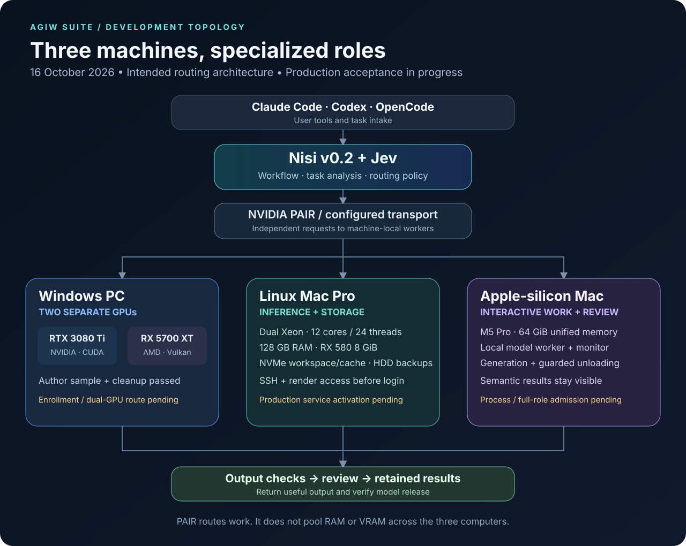
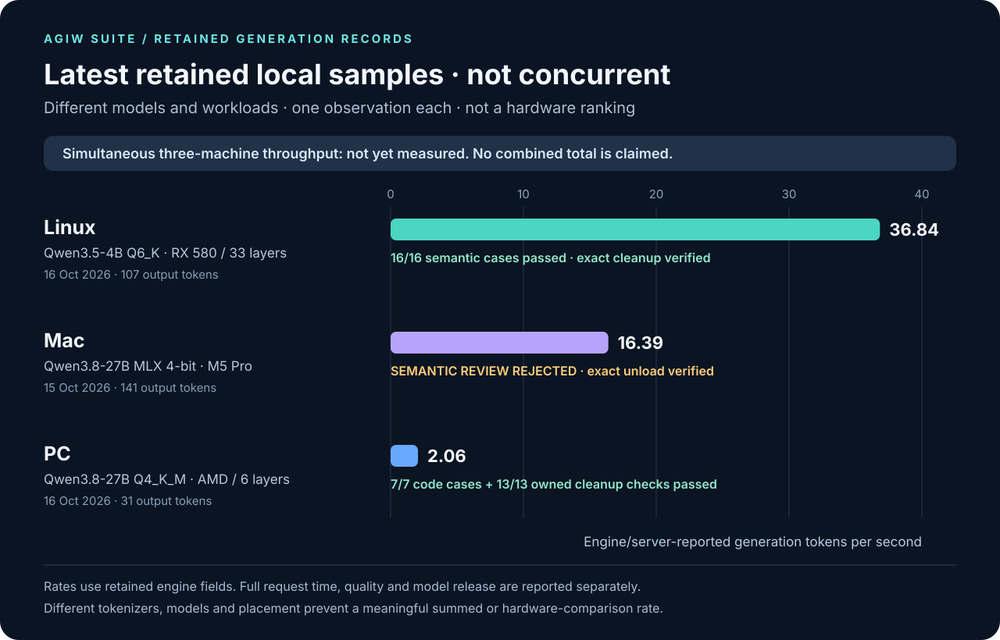

# Two active machines, specialized roles

**Scope change · 2026-10-25.** AGIW now runs on two machines only: the Apple-silicon MacBook Pro and the Windows PC. The Linux Mac Pro 5,1 is retired from AGIW (it is not an inference, review or coordinator node), and the Linux-specific rollout below is shelved. This change reports no new run and adds no readiness claim. Linux material on this page is kept as dated history. The file keeps its original name so existing links still work.

**Current layout · 2026-10-26.** Do not install the Linux observer, the Linux coordinator, or PAIR. The live machines are the MacBook Pro and the Windows PC:

| Service on the PC | Port |
| --- | --- |
| Router | 1234 |
| qwen3.8-27b | 1236 |
| gpt-oss-20b | 1245 |

The Mac's LM Studio serves gpt-oss-20b on 127.0.0.1:1234. The Mac reads the PC lanes through the SSH forwards in [inference-monitor.md](inference-monitor.md), not by opening those ports on the LAN.

AGIW Suite is being developed to coordinate useful AI work across an Apple-silicon Mac and a Windows PC. Earlier plans also included a Linux Mac Pro. Each worker can use an appropriate local model; the workflow retains task results, quality checks and model-lifecycle evidence.

**Status update · 2026-10-23.** This date-scoped documentation refresh adds no machine-readiness claim and reports no new run. Separate machine-local workers may contribute to parallel orchestration, but genuine simultaneous three-machine output rate, task rate and speedup are **NOT MEASURED**. Historical measurements and the earlier development checkpoint below are retained unchanged.

**Historical checkpoint · 16 October 2026 UTC.** Selected Linux and PC code samples passed their bounded checks; the Mac advisory returned and unloaded, but its advice was rejected. Production routing across all three machines and a simultaneous throughput benchmark remain in progress. The downloadable macOS Inference Monitor is a separate release.

## 2026-10-18 update

### Linux system-service rollout (historical; shelved 2026-10-25)

The coordinator is moving from a per-user service to a system service that starts closed: it admits no work until explicitly opened. It will not be enabled at boot until a later, separate step. The rollout is in development and the coordinator has not been started. Each privileged step is preceded by a fresh read-only check of the live machine, and its output is compared byte-for-byte with a predicted result.

Three systemd 259 behaviors were found during the live rollout and handled in the installer:

- An installed but never-started unit is unloaded immediately after each bus call, so `GetUnit` fails; `LoadUnit` works.
- `journalctl --boot=` rejects a dashed boot ID; the 32-character undashed form works.
- `systemctl show` lists `Requires=` and `After=` in a different order on each read of an inactive unit. The new start-recovery path, still in development, compares those lists as sets; the earlier verification and boot-enable checks still compare the raw text and stop safely if the order changes. A running unit kept a stable order across 30 reads, which is bounded evidence, not a guarantee.

Before any one-way step, run the exact observation code read-only on the real machine many times.

### Windows native test results

The Windows edition is in development and is not released. On 2026-10-18, native test suites ran on the Windows 11 PC with Python 3.13 and Node.js 24. Three in-progress hardening workstreams passed fully, with 288 Windows tests each and JavaScript suites of 396–407 tests each. The installer workstream ran 432 Windows tests; its installer directory-guard fix, PowerShell 5.1 test-harness fix and one test-isolation fix remain in progress. Two tests that failed only on macOS were confirmed to pass natively on Windows.

## The topology as planned before 2026-10-25 (historical)

The diagram and table below show the earlier three-machine plan. Since 2026-10-25 only the Windows PC and the Apple-silicon Mac are in scope; the Linux row is retained as history.

Nisi v0.2 and Jev provide the workflow and task-analysis layer. In this withdrawn plan, NVIDIA PAIR could transport independent requests to eligible engines; it did not combine the computers' RAM or VRAM into one model. PAIR is uninstalled. The PC's two GPUs offer distinct placement options. Native admission and a measured workload must establish whether both can be used together for a given configuration.

| Machine | Resources and intended role | Current connection and acceptance state |
| --- | --- | --- |
| **Windows PC · two GPUs** | NVIDIA RTX 3080 Ti 12 GiB for CUDA; AMD RX 5700 XT 8 GiB for Vulkan. Specialized coding and fast advisory lanes. | One native Author sample and its owned cleanup passed. Central enrollment is **off**; complete four-role and dual-GPU routed acceptance remain open. |
| **Linux Mac Pro 5,1 · retired 2026-10-25** | Dual Xeon X5675 CPUs; 12 physical / 24 logical cores; 128 GB installed RAM; RX 580 8 GiB. Samsung system SSD, separate NVMe workspace/cache and two HDD backup volumes. | Pinned SSH works after reboot without a desktop login. A transient background user service successfully opened the GPU render device, exited 0 and was collected, with zero inference calls. The old coordinator is disabled/inactive; the new service is **not installed**, with its source staged. Production inference before login remains unverified. |
| **Apple-silicon Mac** | M5 Pro and 64 GiB unified memory. Interactive work, model review and the monitor interface. | Recorded local runs produced answers and verified exact model unloading. Current process admission and complete four-role acceptance remain open. |

The Linux coding sample uses a reviewed SSE/Vulkan runtime suited to the older Xeons. It did not require AVX or AVX2 CPU support. Storage roles do not make the HDDs equivalent to NVMe speed or combine the drives into a RAID volume.

## Historical single-run local samples · different tasks/configurations · not concurrent

| Machine / observed date | Exact model and placement | Reported generation rate | Output and timing | Quality and release |
| --- | --- | ---: | --- | --- |
| **Linux · 16 Oct** | Qwen3.5-4B Q6_K; RX 580 Vulkan, 33/33 layers offloaded | **36.84 tokens/s** | 107 output tokens; 2.877 s reported generation; 9.587 s model-unit duration including startup/settlement | **16/16 strict semantic cases passed** on one bounded coding sample. Model/controller/child units and socket absent afterward. |
| **Mac · 15 Oct** | Qwen3.8-27B MLX 4-bit | **16.39 tokens/s** | 141 output tokens; 9.389 s full request | **Semantic review rejected the answer:** its suggested test addressed the wrong case. Exact model unload confirmed by fresh inventory. |
| **PC · 16 Oct** | Qwen3.8-27B Q4_K_M; Vulkan, six layers on AMD, CPU KV | **2.06 tokens/s** | 31 output tokens; 14.570 s reported generation; 35.212 s HTTP request | **7/7 bounded clamp cases passed; 13/13 owned cleanup checks passed.** This was not dual-GPU inference. |

Each row is a historical, single-run sample from a different task and configuration. All three rates come directly from their retained engine/server fields. Each row contains one observation, with no repeats or variance estimate. In the two llama.cpp records, the rate matches `(output tokens − 1) / generation seconds`: Linux uses 106 / 2.877274 and PC uses 30 / 14.570342. The total output counts remain 107 and 31. We preserve the reported fields instead of recalculating a different metric. They use different models, tasks, device placement and timing implementations. Tokenizers also differ. The values show what happened in those samples; they do not rank the machines, establish general accuracy, or predict a combined rate. Linux's sample ran with its coordinator stopped, the PC was a direct native qualification, and the Mac was a supervised local advisory.

The older [historical performance study](performance.md) remains available with its original methods and dates. Its earlier peaks are separate from these three single-run samples. [Download the sanitized historical measurements](data/three-machine-checkpoint-20261016/metrics.json).

## Simultaneous multi-machine performance · NOT MEASURED

The in-scope measurement is now a shared two-machine run on the Mac and the PC. The Linux row is listed only because it was part of the earlier plan; it will not be measured.

| Measurement requiring one shared, overlapping run | Result |
| --- | --- |
| Proven simultaneous generation on both active machines (Mac and PC) | **NOT MEASURED** |
| PC output tokens/s during that run | **NOT MEASURED** |
| Linux output tokens/s during that run | **Out of scope** (Linux retired 2026-10-25) |
| Mac output tokens/s during that run | **NOT MEASURED** |
| Combined output tokens/s over the common run window | **NOT MEASURED** |
| Validated task rate and failure rate | **NOT MEASURED** |
| Speedup against a defined baseline | **NOT MEASURED** |

A shared benchmark follows service activation and role admission. It will use one controller's monotonic clock for dispatch and completion, prove overlapping generation intervals, and retain exact serving-machine/model attribution. Each node's output-token counts and generation time will be recorded beside task pass/fail results and verified model release.

The cluster rate will be **total completed output tokens divided by the batch wall time**, reported separately from engine generation rates. Cold starts, queue time and retries must remain visible. No aggregate is published until that common run exists; unavailable values are `null` in the data.

## Next checkpoints

1. Complete Mac process admission and PC enrollment, qualify the remaining model roles and preserve existing work.
2. Run the bounded two-machine (Mac and PC) workload, measure overlap and useful output, and publish rates together with quality and memory-release results.

The earlier first checkpoint, activating the Linux coordinator, was withdrawn on 2026-10-25 when the Mac Pro was retired from AGIW.

[Linux startup check](data/three-machine-checkpoint-20261016/linux-startup.json) · [Project roadmap](../roadmap.md) · [Released macOS Monitor](../README.md)
